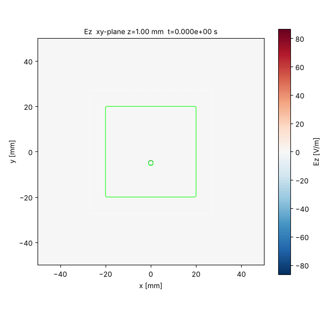
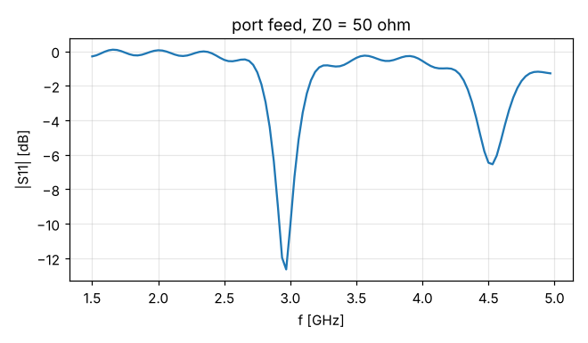

# ADI-FDTD — Unconditionally Stable 3D Electromagnetic Solver

A 3D ADI-FDTD (Alternating-Direction-Implicit Finite-Difference Time-Domain) solver.

* A text input file defines the grid, materials (ε_r, μ_r, σ, σ_m), conductors (PEC), PML and ports.
* Structures can be read from **external unstructured mesh files** (Gmsh `.msh`, STL).
* The grid is a **non-uniform rectilinear grid**, so it can be refined locally around structures.
* Ports drive an impressed electric field. Outputs are GIF animations of the E and H fields, plus port voltage/current (S11).

```
pip install -e .                                   # install (numpy, matplotlib, pillow)
python -m adifdtd examples/dipole.txt              # run
python -m adifdtd input.txt -o result_dir          # choose the output folder
python -m adifdtd.postproc result_dir/ports.csv    # compute S11 (png, csv)
python tests/test_solver.py; python tests/test_mesh.py
```

> **Note (Windows):** pass the *module name* to `-m`, not a path.
> `python -m adifdtd ...` works; `python -m .\adifdtd ...` fails with
> "Relative module names not supported". Without `pip install -e .`, run from
> the repository root (the folder that contains `adifdtd/`).

| Patch antenna (Gmsh mesh, non-uniform grid) | S11 |
|---|---|
|  |  |

---

## 1. Numerical method

| Item | Description |
|---|---|
| Time stepping | Zheng/Namiki ADI (Peaceman–Rachford), two sub-steps per step. Tridiagonal systems along grid lines are solved with the Thomas algorithm (LU pre-factorised) |
| Stability | Stable for any Δt. Spectral radius of the amplification matrix = 1 verified up to CFL 200 for non-uniform grid + ε/μ/σ/σ_m + PML + ports |
| Grid | Non-uniform rectilinear Yee grid. Outer boundary is PEC (behind the PML) |
| Materials | Per-cell ε_r, μ_r, σ (electric loss), σ_m (magnetic loss). E edges use the area-weighted mean of the 4 adjacent cells; H faces use the harmonic mean (μ) of the 2 adjacent cells |
| Geometry input | Boxes (grid indices or physical coordinates) + Gmsh/STL mesh regions |
| PML | Graded impedance-matched lossy layer (σ_e/ε = σ_m/μ, matched also inside dielectric/magnetic media) |
| Port | Lumped resistive voltage source with internal resistance R. A matched R absorbs returning waves |

### Unstructured meshes vs. the FDTD grid
ADI solves tridiagonal systems along grid lines, so it **requires a rectilinear grid**. It cannot time-step directly on a tetrahedral mesh.
The solver therefore works as follows:

1. Structures are defined as **unstructured meshes** (tetrahedra, triangles, lines) made in CAD or Gmsh.
2. The solver maps the mesh onto a **non-uniform rectilinear FDTD grid**:
   * **Volume regions** (tetrahedra, or a closed STL surface): the boundary surface is extracted and the interior is found by ray parity along z. Each cell gets a **volume fraction** from `subcell³` sample points, and ε, μ, σ are blended by that fraction (reduces staircase error). PEC volumes zero every E edge inside or on the surface, including faces and edges.
   * **Surface regions** (triangles): thin PEC sheets. Sample points snap to the nearest grid node, and every edge whose two nodes both lie on the sheet becomes PEC.
   * **Line regions** (line elements): thin PEC wires, snapped as a staircase path.
3. Thin structures and interfaces are refined locally with `xlines/ylines/zlines`. Unconditional stability is kept, so Δt can be chosen from the frequency of interest rather than the smallest cell.

### PML choice
CPML (stretched coordinates) and split-field PML both grew exponentially with ADI at CFL > 1 (amplification-matrix |λ| ≈ 1.02–1.3). This code therefore uses a matched lossy PML, where losses enter only as diagonal terms. Each sub-step operator is then "skew-symmetric + dissipative", which guarantees unconditional stability.

* `uniaxial` (default): in a layer normal to axis d, only the tangential components (c ≠ d) are lossy. Reflectionless at normal incidence.
* `isotropic`: every component is lossy.

Performance (8 cells, compared with a large-domain reference): −45 to −50 dB at CFL 2, −22 to −30 dB at CFL 5 (3.5 steps per period). **At least 10 time steps per period** of the highest frequency of interest are recommended.

### Validation
| Item | Result |
|---|---|
| Unconditional stability | Spectral radius 1.000000 for non-uniform grid, ε/μ/σ/σ_m, PEC, port and PML combined (CFL 30, 200) |
| μ implementation | Medium inserted in a parallel-plate line: ε=4 and μ=4 give the same reflection magnitude (duality). ε=μ=4 (impedance-matched) gives a reflection of 0.02. Delays agree with theory for n=2 and 4 within ±2 steps |
| Non-uniform grid | Outer region graded by 1.8× vs. uniform grid: probe signals differ by 1.1% |
| Mesh mapping | Volume error of an 8 mm-radius STL sphere: 0.7%. Tetrahedral cube volume exact |
| Patch antenna | FR-4 patch resonance 2.97 GHz (S11 −12.6 dB). −7% vs. the transmission-line model (3.18 GHz), typical of the staircase approximation at PEC sheet edges |
| Port reflection suppression | With matched R, the second echo from a shorted end is about −20 dB; with a mismatched R (10×) the echoes repeat |

---

## 2. Input file format

Each line is `keyword positional... key=value...`. Text after `#` is a comment. Units are SI (m, s, S/m).

### Grid
| Keyword | Form | Description |
|---|---|---|
| `grid` + `cell` (+ `origin`) | `Nx Ny Nz` / `dx [dy dz]` / `x0 y0 z0` | Uniform grid |
| `xlines` `ylines` `zlines` | `x0  x1:n1[:r1]  x2:n2[:r2] ...` | Non-uniform axis. Segment [x_{k-1}, x_k] is split into n_k cells. r_k = last/first cell size (geometric grading, default 1) |
| `cfl` | `value` | Δt = value × Yee CFL limit of the smallest cell (may exceed 1) |
| `dt` | `seconds` | Δt directly |
| `steps` | `N` | Number of time steps |

Axes can be mixed: e.g. x and y uniform via `grid`/`cell`, z only via `zlines`.
A neighbouring cell-size ratio of 2 or less is recommended.

```
xlines -0.050  -0.022:12:0.25  0.022:44  0.050:12:4    # 4 mm outside -> 1 mm centre -> 4 mm outside
zlines -0.030  -0.002:10:0.2   0.0:4  0.0016:4  0.004:5  0.032:10:5
```

### PML
| Keyword | Form | Description |
|---|---|---|
| `pml` | `n` / `nx ny nz` / `xmin xmax ymin ymax zmin zmax` | PML thickness per face (cells). Options `type= order= r0=` |
| `pml_type` / `pml_order` / `pml_reflection` | | `uniaxial`\|`isotropic` / grading order m (default 3) / theoretical reflection R0 (default 1e-4) |

### Box structures
Box indices are **grid node numbers** `i0 i1 j0 j1 k0 k1` by default. With `coords=phys` they are read as **physical coordinates [m]** and snapped to the nearest node.

| Keyword | Form |
|---|---|
| `conductor` | `i0 i1 j0 j1 k0 k1 [coords=phys]` — PEC box (one equal pair = plate, two equal pairs = wire) |
| `material` (=`dielectric`) | `i0 i1 j0 j1 k0 k1 eps= mu= sigma= sigma_m= [coords=phys]` |

### Mesh structures
```
mesh   file=patch.msh scale=1e-3 offset=0,0,0 subcell=2
region substrate type=material eps=4.4 mu=1 sigma=0.015 sigma_m=0
region ground    type=pec
region 4         type=pec
stl    file=sphere.stl scale=1e-3 offset=0.005,0,0 type=material eps=2 mu=3 subcell=3
```
* `mesh`: reads a mesh file (path relative to the input file). `scale` converts mesh units to metres, `offset` is a translation [m], `subcell` is the number of volume-fraction samples per axis.
* `region <physical group number or name>`: assigns a material to a physical group of the preceding `mesh`.
  * `type=material`: volume regions only. Set `eps`, `mu`, `sigma`, `sigma_m`.
  * `type=pec`: volume (solid conductor), surface (thin sheet) or line (wire).
* `stl`: reads one closed STL surface as a volume region. Give `type` and material on the same line.
* Supported formats: Gmsh `.msh` ASCII v2.2/v4.1 (1st/2nd-order lines, triangles, tetrahedra), STL ASCII/binary.
* Order: entries overwrite each other in input-file order. PEC always wins over materials.

### Ports
```
port 0 0 -0.005 -0.005 0 0.0004 coords=phys dir=+z amp=2500 R=50 wave=modgauss f0=3.2e9 tau=2.5e-10 name=feed
```
* `dir`: direction of the impressed field, `±x, ±y, ±z`. The box must span at least one cell along this axis.
* `amp`: impressed field strength [V/m]. Open-circuit EMF = amp × port length.
* `R`: internal resistance [Ω]. Matching it to the line impedance absorbs reflected waves.
* Widening the port across the transverse directions makes a sheet port.
* Waveforms:
  * `gauss` (`tau`, `t0`)
  * `modgauss` (`f0`, `tau`, `t0`)
  * `sin` (`f0`, `ramp`)
  * `ricker` (`f0`, `t0`)

### Output
```
output E comp=z   plane=xy pos=0.0008 interval=8 file=Ez.gif
output H comp=mag plane=xz index=20   interval=5 fps=15 clim=2.0 gridlines=yes
```
* `comp`: `x`, `y`, `z`, `mag`
* `plane`: `xy`, `xz`, `yz`
* The plane position is given by `pos=` (physical coordinate [m]) or `index=` (cell number).
* `interval`: GIF save interval (steps)
* `clim`: fixed colour range (default: 99.5th percentile)
* `gridlines=yes`: draws the non-uniform grid lines.
* GIF axes are in physical coordinates [mm]. Conductors (black), materials (green), ports (cyan) and the PML boundary (grey dashed) are drawn.

If ports exist, `ports.csv` (t, E_s, mean E, voltage V, current I) is written. S11 is computed with `python -m adifdtd.postproc`.

---

## 3. Examples

| Folder / file | Description |
|---|---|
| `examples/mesh_patch/` | Probe-fed FR-4 patch antenna. Reads the substrate (tetrahedra), ground and patch (triangle sheets) and feed pin (line) from `patch.msh` (Gmsh). Non-uniform grid (0.4 mm substrate, 1 mm centre, 4 mm outside), CFL 4.3. About 1.5 min |
| `examples/mesh_sphere/` | `sphere.stl` (magneto-dielectric sphere, ε_r=2, μ_r=3) + dipole scattering. Boxes and port in physical coordinates |
| `examples/dipole.txt` | Gap-fed dipole + dielectric block (uniform grid, index coordinates) |
| `examples/parallel_plate_short.txt` | Parallel-plate line + matched sheet port + short (reflection absorption check) |

Regenerating meshes: `pip install gmsh`, then `python examples/mesh_patch/make_mesh.py`. Alternatively, open `patch.geo` in the Gmsh GUI and export an ASCII `.msh`.

```
cd examples/mesh_patch
python -m adifdtd patch_antenna.txt
python -m adifdtd.postproc output_patch/ports.csv --fmin 1.5e9 --fmax 5e9
```

## 4. Code layout

```
adifdtd/
  inputfile.py   input parser, configuration data structures
  grid.py        non-uniform rectilinear grid (node coordinates, primal/dual spacing)
  meshfile.py    Gmsh .msh (v2.2/v4.1) and STL readers
  geometry.py    mesh/box -> grid mapping (ray-parity voxelisation, volume fractions, sheet/wire snapping)
  solver.py      ADI-FDTD core (coefficients, tridiagonal factorisation, sub-step updates, ports)
  waveforms.py   port excitation waveforms
  output.py      plane-slice sampling, GIF writing
  postproc.py    ports.csv -> S11
tests/           stability (eigenvalue) tests, mesh reader / voxeliser tests
```
