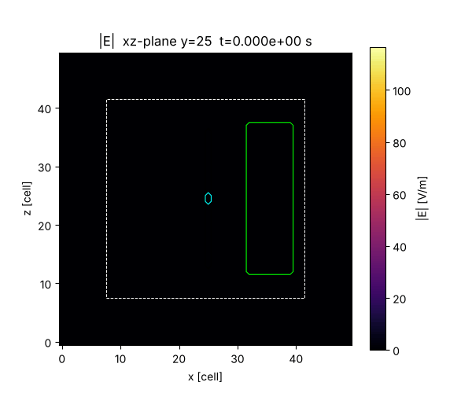

# ADI-FDTD — 3D 무조건 안정 전자기장 솔버

3차원 ADI-FDTD(교호 방향 음해법 FDTD) 솔버입니다. 텍스트 인풋 파일로 격자, 도체(PEC), 유전체, PML, 포트를 지정합니다. 포트에 전기장을 가해 여기하며, 출력은 E·H 필드의 GIF 애니메이션입니다.

```
python -m adifdtd examples/dipole.txt          # 실행
python -m adifdtd input.txt -o result_dir      # 출력 폴더 지정
python tests/test_solver.py                    # 검증 테스트
```

필요 패키지: `numpy`, `matplotlib`, `pillow` (`pip install -r requirements.txt`)



---

## 1. 수치 기법

| 항목 | 내용 |
|---|---|
| 시간 적분 | Zheng/Namiki ADI (Peaceman–Rachford) 2-서브스텝. 각 서브스텝에서 격자선 방향 3중대각 행렬을 Thomas 알고리즘으로 풂 (LU 사전 분해) |
| 안정성 | Δt에 무관하게 안정 (CFL 제한 없음). 테스트에서 CFL 100까지 증폭행렬 스펙트럼 반경 = 1 확인 |
| 격자 | Yee 격자. 외곽 경계는 PEC (PML 뒤쪽) |
| 유전체 | 셀 단위 ε_r, σ. 경계 edge에서는 인접 4셀 평균 |
| 도체 | PEC 박스 (두께 0 판, 선 가능). 내부·표면의 접선 E = 0 |
| PML | 등급형 임피던스 정합 손실층 (σ_e/ε = σ_m/μ), polynomial grading |
| 포트 | 내부저항 R을 가진 lumped 저항성 전압원. 정합 R이면 되돌아온 파를 흡수 |

### PML 방식 선택 이유
CPML(stretched coordinate)과 Berenger split-field PML도 구현해 봤으나, ADI와 결합하면 두 서브스텝 연산자가 공통 에너지 노름을 잃어 CFL > 1에서 지수적으로 발산했습니다 (증폭행렬 고유값 |λ| ≈ 1.02–1.3). 문헌에서도 ADI + PML의 late-time 불안정성이 보고됩니다.
본 코드는 손실을 대각항으로만 넣는 정합 손실형 PML을 씁니다. 각 서브스텝 연산자가 "반대칭 + 소산" 형태가 되므로 **무조건 안정이 보장**됩니다.

* `uniaxial`(기본): 면에 수직인 축 d의 층에서 접선 성분(c ≠ d)에만 손실을 줍니다. 수직 입사에서 무반사이며, UPML 텐서에서 법선 성분(1/s)만 뺀 형태입니다.
* `isotropic`: 모든 성분에 손실을 줍니다.

PML 성능 (8셀, 경계에서 3셀 떨어진 프로브, 대형 도메인 기준해와 비교):

| CFL | uniaxial | isotropic |
|---|---|---|
| 2 (주기당 약 9 스텝) | −45 ~ −50 dB | −40 ~ −45 dB |
| 5 (주기당 약 3.5 스텝) | −22 ~ −30 dB | — |

ADI는 Δt가 커질수록 수치 분산이 커집니다. 관심 최고주파수 기준으로 **주기당 10 스텝 이상**을 권장합니다.

### 포트 (반사파 억제)
포트 edge에서 다음 식을 풉니다.

  ε ∂E/∂t + σ_p E = ∇×H + σ_p E_s(t)

σ_p는 포트 전체 저항이 R이 되도록 정합니다 (길이 방향 nL개 edge 직렬, 단면 nA개 병렬). 그러면 포트는 "기전력 E_s·L + 내부저항 R"인 전압원처럼 동작합니다. R을 선로 임피던스에 맞추면 되돌아온 파가 저항에서 흡수되어 재반사가 억제됩니다.
`examples/parallel_plate_short.txt` 검증 결과 (끝단 단락 선로):
R = Z0(36 Ω)이면 2차 에코가 약 −20 dB이고, R = 360 Ω이면 에코가 반복됩니다.

---

## 2. 인풋 파일 형식

한 줄에 `키워드 위치인자... key=value...` 형식으로 씁니다. `#` 뒤는 주석입니다.
**박스 인덱스는 격자 노드 번호**(0 … N)이며, `i0 i1 j0 j1 k0 k1` 순서입니다.

| 키워드 | 형식 | 설명 |
|---|---|---|
| `grid` | `Nx Ny Nz` | 전체 도메인 셀 수 |
| `cell` | `dx [dy dz]` | 셀 크기 [m] |
| `cfl` | `값` | Δt = 값 × Yee CFL 한계 (1보다 커도 됨) |
| `dt` | `초` | Δt 직접 지정 (`cfl`보다 우선) |
| `steps` | `N` | 시간 스텝 수 |
| `pml` | `n` / `nx ny nz` / `xmin xmax ymin ymax zmin zmax` | 각 면 PML 두께(셀). 옵션 `type= order= r0=` |
| `pml_type` | `uniaxial` \| `isotropic` | PML 손실 방식 |
| `pml_order` | `m` | σ(ρ) = σmax ρ^m (기본 3) |
| `pml_reflection` | `R0` | 이론 수직 반사계수 (기본 1e-4) |
| `conductor` | `i0 i1 j0 j1 k0 k1` | PEC 박스. 한 축이 같으면 판, 두 축이 같으면 선 |
| `dielectric` | `i0 i1 j0 j1 k0 k1 eps=ε_r sigma=σ` | 유전체 박스 (셀 i0…i1-1). 나중 줄이 우선 |
| `port` | `i0 i1 j0 j1 k0 k1 dir= amp= R= wave= ...` | 포트 (아래 참고) |
| `output` | `E\|H comp= plane= index= interval= file= fps= clim=` | GIF 출력 |
| `outdir` | `경로` | 출력 폴더 (기본 `output`) |
| `dtype` | `float64` \| `float32` | 연산 정밀도 |

### port
```
port 25 25 25 25 24 26 dir=+z amp=1000 R=50 wave=modgauss f0=10e9 tau=6e-11 name=feed
```
* `dir` : 인가 전기장 방향 `±x, ±y, ±z`. 박스는 이 축으로 1셀 이상 길이가 있어야 합니다.
* `amp` : 인가 전기장 세기 [V/m]. 개방 기전력 = amp × 포트 길이.
* `R` : 포트 내부저항 [Ω]. 선로 임피던스와 같게 두면 반사파를 흡수합니다.
* 단면 방향으로 넓히면 sheet 포트가 됩니다 (예: 평행판 선로 전체 폭).
* `wave` 종류:
  * `gauss` (`tau`, `t0`)
  * `modgauss` (`f0`, `tau`, `t0`) — 가우시안 변조 정현파
  * `sin` (`f0`, `ramp` = 램프 주기 수)
  * `ricker` (`f0`, `t0`)

### output
```
output E comp=mag plane=xz index=25 interval=3 file=E_mag_xz.gif
output H comp=z   plane=xy index=20 interval=5 fps=15 clim=2.0
```
* `comp` : `x`, `y`, `z`, `mag`(크기)
* `plane` : `xy`, `xz`, `yz`. `index`는 법선 방향 셀 번호 (기본 중앙)
* `interval` : 저장 간격(스텝). 이 간격마다 GIF 프레임 1장
* `clim` : 컬러 범위 고정 (기본: 전체 프레임의 99.5 백분위)
* GIF에 도체(검정), 유전체(연두), 포트(하늘색), PML 경계(흰 점선)가 표시됩니다.

포트가 있으면 `ports.csv`(t, E_s, 포트 평균 E, 전압 V, 전류 I)도 저장합니다.

---

## 3. 예제

| 파일 | 내용 |
|---|---|
| `examples/dipole.txt` | 갭 급전 다이폴 + 유전체 블록, 개방 공간 방사 (50³, CFL 3) |
| `examples/parallel_plate_short.txt` | 평행판 선로 + 정합 sheet 포트 + 끝단 단락 (반사 흡수 확인) |

## 4. 코드 구성

```
adifdtd/
  inputfile.py   인풋 파서, 설정 데이터 구조
  solver.py      ADI-FDTD 코어 (계수, 3중대각 분해, 서브스텝 갱신, 포트)
  waveforms.py   포트 여기 파형
  output.py      평면 슬라이스 샘플링, GIF 작성
  __main__.py    CLI
tests/test_solver.py   증폭행렬 고유값 안정성 테스트, 실행 테스트
```

성능 참고: 50³ 격자 약 50 ms/step (NumPy, 단일 프로세스).
